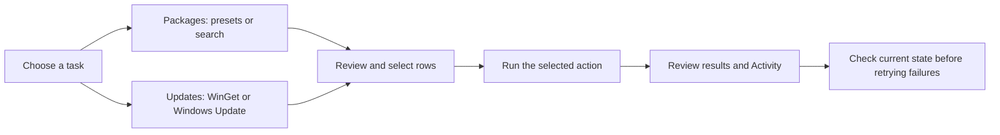
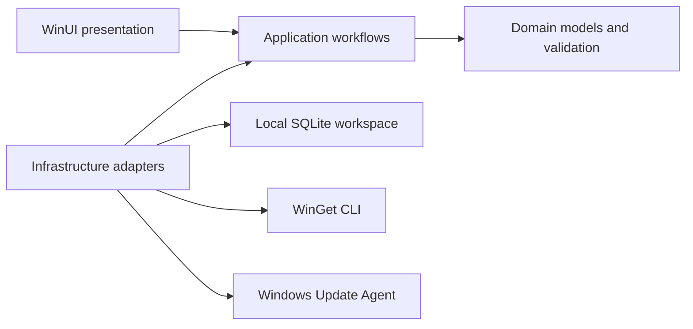

# OnlyWinget

<p align="center">
  
</p>

<p align="center">
  
  
  
</p>

OnlyWinget is a Windows desktop app for preparing reusable lists of applications, finding packages, and reviewing WinGet and Windows updates in one WinUI 3 interface.

## What you can do

| Task | Where to start |
| --- | --- |
| Create, edit, import or export a package list; install or uninstall selected entries | **Packages → Presets**. Exchange files use `onlywinget.preset.v1`; package identity includes both ID and source. |
| Search enabled WinGet sources and install selected results directly or add them to a preset | **Packages → Search**. Results include package ID, source and version. |
| Scan for application upgrades and apply selected rows | **Updates → WinGet**. Results and diagnostics remain available after failures or cancellation. |
| Scan Windows Update and install selected updates | **Updates → Windows Update**. Separate options control software, drivers, Microsoft updates and optional updates. |
| Refresh source metadata, enable or disable sources locally, add, remove or reset sources | **Sources**. Add, remove and reset require an elevated app. |
| Read, filter, copy or export activity and diagnostic logs | **Activity** and **Open logs**. |
| Choose English/Italian, system/light/dark appearance and operation preferences | **Settings**. Changes save automatically. |



See the [Italian user guide](docs/user-guide.md) for each workflow and recovery path.

## Requirements

- Windows 10 build 17763 or later, or Windows 11, on x64. This is the project's declared target; it is not a claim of testing on every Windows release.
- Microsoft App Installer providing `winget` on `PATH` for package operations.
- Network access to the selected package sources or update service for discovery and downloads.
- Administrator rights for source add/remove/reset and Windows Update installation. Package installers can have their own elevation requirements.

The setup and portable ZIP bundle .NET and Windows App Runtime dependencies. OnlyWinget starts with `asInvoker`; it does not automatically restart itself with administrator rights.

## Get started

For published builds, check [GitHub Releases](https://github.com/dennidalpos/OnlyWinget/releases). The supported distribution formats are an x64 NSIS setup EXE and a self-contained x64 portable ZIP. If the Releases page has no assets, use the source instructions below.

1. Run the setup, or extract the entire portable ZIP and open `OnlyWinget.exe`.
2. Open **Sources** and check which sources are available and enabled.
3. Open **Packages → Search** to find applications, or create a preset under **Packages → Presets**.
4. Review the selected entries before starting an install, uninstall or update. Check **Activity** for the outcome.

Portable describes the application files: settings and workspace still use `%LOCALAPPDATA%\OnlyWinget` by default.

## Build and run from source

Use PowerShell 7 and the exact .NET SDK pinned in [global.json](global.json). From the repository root:

```powershell
winget --version
dotnet --version
pwsh -File .\scripts\run.ps1 -Task Setup -NonInteractive
pwsh -File .\scripts\run.ps1 -Task Build -Configuration Release -NoRestore -NonInteractive
pwsh -File .\scripts\run.ps1 -Task Dev -Configuration Release -NoRestore -NonInteractive
```

`Dev` launches an existing build. The scripts can install missing prerequisites where supported; set `ONLYWINGET_SKIP_AUTO_INSTALL=1` to fail instead. Setup creation also requires NSIS 3.x. See [script reference](scripts/README.md) and [operations](docs/operations.md) for checks, output locations and isolated app-data runs.

## Data and operational limits

Presets and the active-preset choice use SQLite (`onlywinget.db`); settings, source preferences and diagnostic logs are stored beside it under `%LOCALAPPDATA%\OnlyWinget`. Activity is kept in the current app session and can be exported. Legacy workspace JSON can be imported on startup. Diagnostic files rotate at 10 MiB, with retention of at most 14 recognized files / 140 MiB after successful writes.

Only one workflow runs at a time. Cancellation requests a stop and preserves available results; it does not roll back installations or prove that a native update has stopped. Check installed state before retrying an unconfirmed package. A failed or cancelled apply does not trigger an automatic rescan.

Windows Update uses asynchronous COM jobs, with PowerShell fallback when COM cannot be activated. An installation failure is not retried automatically through the fallback. Real download/install qualification and upgrade reconciliation against an authentic older installer remain limited; see [operations](docs/operations.md#windows-update-metadata) and [release checks](docs/release.md).

## Architecture and documentation



Arrows between layers show code dependencies; `AppComposition.cs` connects the adapters at startup.

- [Documentation index](docs/README.md)
- [User guide — Italiano](docs/user-guide.md)
- [Architecture](docs/architecture.md)
- [Development and troubleshooting](docs/operations.md)
- [Release and packaging](docs/release.md)

## Support

Report reproducible problems through [GitHub Issues](https://github.com/dennidalpos/OnlyWinget/issues), including the app version, Windows version, affected workflow and error code. Review exported logs before attaching them: they can contain package names, source addresses and local paths.

## License

OnlyWinget is proprietary software. Copyright (c) 2026 Danny Perondi. All rights reserved.
