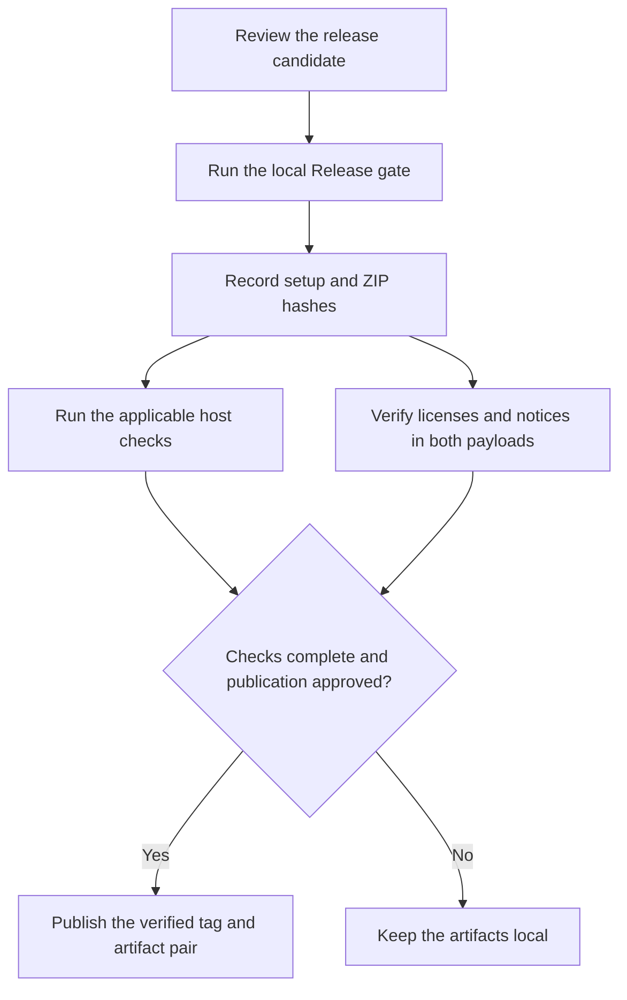

# Release

## Version

The current project version is declared in `src/OnlyWinget/OnlyWinget.csproj`. Change the version only with owner approval. For a patch release, update these four properties together and check that the landing links match the intended download filenames.

```xml
<Version>1.0.PATCH</Version>
<AssemblyVersion>1.0.PATCH.0</AssemblyVersion>
<FileVersion>1.0.PATCH.0</FileVersion>
<InformationalVersion>1.0.PATCH</InformationalVersion>
```

Use annotated tags named `v1.0.PATCH`.

## Required Checks

Run the local gate in an isolated checkout of the candidate. `Check` clears that checkout's generated outputs.

```powershell
.\scripts\run.ps1 -Task Check -Configuration Release -NonInteractive
```

GitHub Actions is currently disabled. The checked-in workflows install Chocolatey package `nsis` version `3.13.0` and verify compiler `v3.13` before running Check. Use NSIS for the local native ownership fixtures and packaging. See the [NSIS release](https://nsis.sourceforge.io/Download).

On a clean Windows test host, run the lifecycle test against the candidate installer. The default `AllUsers` scope requires elevation.

```powershell
.\scripts\run.ps1 -Task ValidateInstallerLifecycle -Configuration Release -NoRestore -NonInteractive
```

The default lifecycle run validates clean install/uninstall only and reports upgrade as not_run. For a real upgrade, use the lifecycle script directly with `-PreviousSetupPath` pointing to a genuine earlier release and optional `-PreviousVersion` to assert its installed version. `-PreviousVersion` alone fails before machine changes; rebuilding the current payload under an older label is no longer supported as upgrade evidence. Reconciliation of removed or renamed installer-owned files still requires an authentic older payload.

Clean install/uninstall checks do not establish successful upgrade reconciliation or real Windows Update download/install qualification. Those checks require their own target environments and evidence.

The November 2026 verification covered the local Release gate and isolated startup on Windows 11. Native theme changes on Windows 10 and the real lifecycle of the current installer still require host checks.



The packaging task permits only one run per worktree. Setup and portable outputs are built under unique staging directories on the destination volume, then validated before promotion. The setup must be a nonempty MZ executable; every ZIP file is checked against the published payload by path, length and SHA-256, including hidden files. Each final file is replaced individually with `File.Replace` (or moved on first publication), while a flushed journal and verified backups retain the previous pair for rollback.

A failed promotion restores the prior pair; the next packaging invocation recovers an interrupted promotion before rebuilding. Corrupt journals/backups fail closed and remain for inspection. The two filenames do not form one atomic filesystem transaction: readers can briefly observe different generations between replacements, so consume artifacts after packaging exits successfully. Process interruption is covered by the regression; hardware/power-loss behavior is not qualified. Interrupted staging directories can remain as generated evidence; ordinary successful/failed runs remove their own staging files.

The release workflow checks out the explicit tag, validates all four project version properties against it and runs the full `Check` gate on that commit before publication. Immediately before publication it verifies HEAD still matches the resolved SHA, the remote tag still resolves to that SHA, and both exact-version supported assets exist and are nonempty. Missing asset patterns also fail the release action.

For manual dispatch, supply an existing `vMAJOR.MINOR.PATCH` tag; a dispatch from a branch without an explicit tag fails. The selected dispatch branch cannot substitute its payload for the tag's payload. No release is published if the gate or validation fails.

Distribution is NSIS setup EXE plus self-contained portable ZIP only. The unused `PackageMsix` task, script and package manifest have been retired; no MSIX signing secret is consumed. Build-gate uploads both supported formats and retains TRX/build-report evidence.

The standalone `build-gate` workflow remains available for branch/PR verification. Its two-commit checkout supports the isolated release mismatch regression; release checkout fetches full history and tags.

Local release-contract regression:

```powershell
.\scripts\test-release-validation.ps1
```

This uses isolated local clones and sentinel assets, accepts lightweight/annotated tags, and rejects wrong checkout refs, versions, expected SHAs, missing/empty assets and remote tag drift. It creates no commits or release and runs in the full gate. AUDIT-12's [hosted negative qualification](tracker-review-2026-10-18.md#continuation--audit-12-hosted-negative-qualification-completed) verifies actual version-mismatch and full-Check failures with the publisher skipped, using unchanged production commands/default failure conditions in a read-only branch fixture. That fixture must not be merged into production. Positive release publication and shipping checks for a future genuine release tag remain unqualified by those negative tests.

`scripts/test-package-artifacts.ps1` runs the production artifact helpers against isolated sentinels and a minimal real NSIS fixture. It covers compiler/compression/validation/promotion failures, child-process interruption and recovery, corrupt journals/backups, hidden payload files and first publication. The full `Check` gate includes this regression.

## Artifact

Review [CREDITS.md](../CREDITS.md#redistribution-check) and compare `ThirdPartyNotices` in the exact portable ZIP and installed setup against the packaging output. The setup also supplies `ThirdPartyNotices/NSIS` with the matching LZMA license, source availability notice and source archive. Record SHA-256 for both artifacts and confirm the Microsoft redistribution and end-user terms before distribution.

`landing/build/` contains a tracked directory marker. Download binaries and their backups stay local. Check the exact filenames and SHA-256 hashes against the intended build before uploading the landing files.

Install and uninstall request graceful closure only for `$INSTDIR\OnlyWinget.exe`, using the embedded PowerShell helper. It waits up to five seconds per verified owned process; a refused close exits nonzero before file extraction or file/registry removal. Exited processes, null modules and expected access errors are ignored without closing the process; unexpected query errors still stop the operation. Other executable copies are preserved. An unreadable path provides no ownership evidence and does not prove the installation is unlocked. The 32-bit NSIS bootstrap invokes 64-bit Windows PowerShell through `Sysnative`; no process-name kill or forced termination is used. `scripts/test-process-ownership.ps1` covers deterministic inaccessible/null-module candidates in PowerShell 7 and Windows PowerShell 5.1, plus the production macro on isolated windows during both install and uninstall, another running portable copy and a refused close.

Publish the unified setup EXE and portable ZIP:

```text
artifacts/dist/OnlyWinget/Release/OnlyWinget-1.0.PATCH-setup.exe
artifacts/dist/OnlyWinget/Release/OnlyWinget-1.0.PATCH-portable-x64.zip
```

## Tag

Tag creation, push and GitHub release publication require explicit authorization. The commands below are a release template; replace `PATCH` with the approved version.

```powershell
git tag -a v1.0.PATCH -m "OnlyWinget 1.0.PATCH"
git push origin v1.0.PATCH
```

Publish the GitHub release from that verified tag and attach the setup EXE and portable ZIP.
