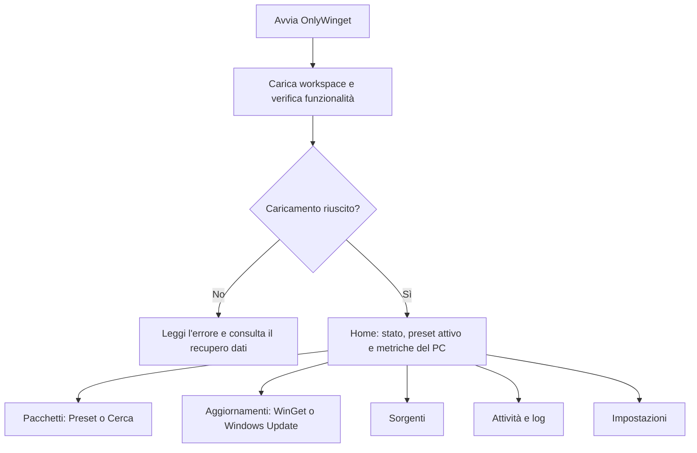
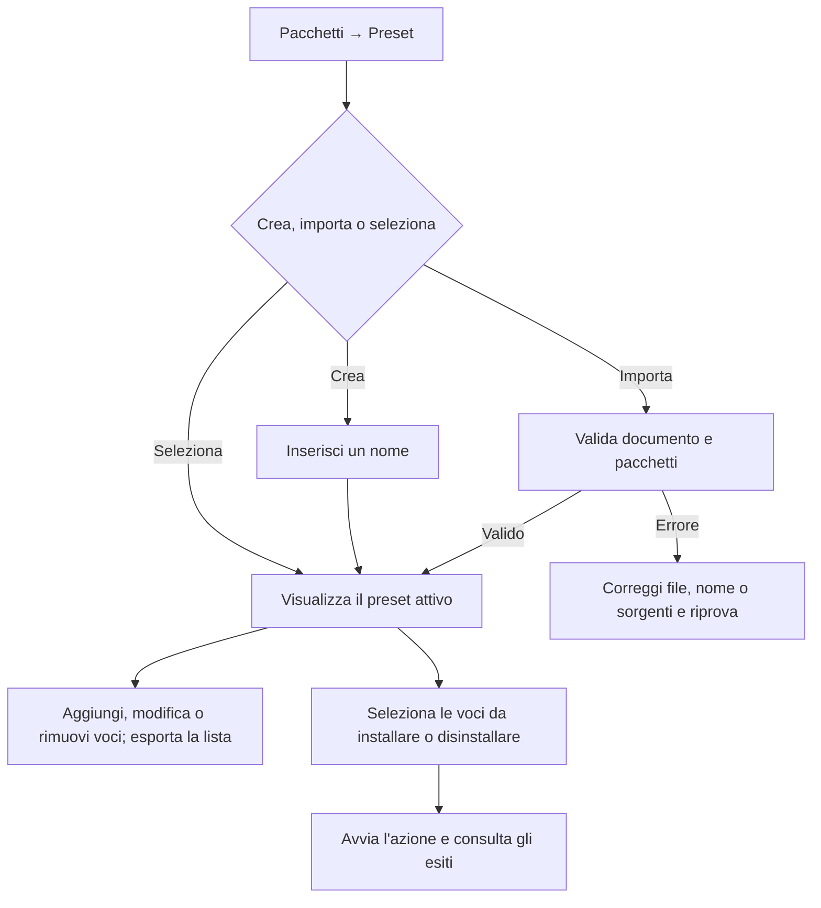
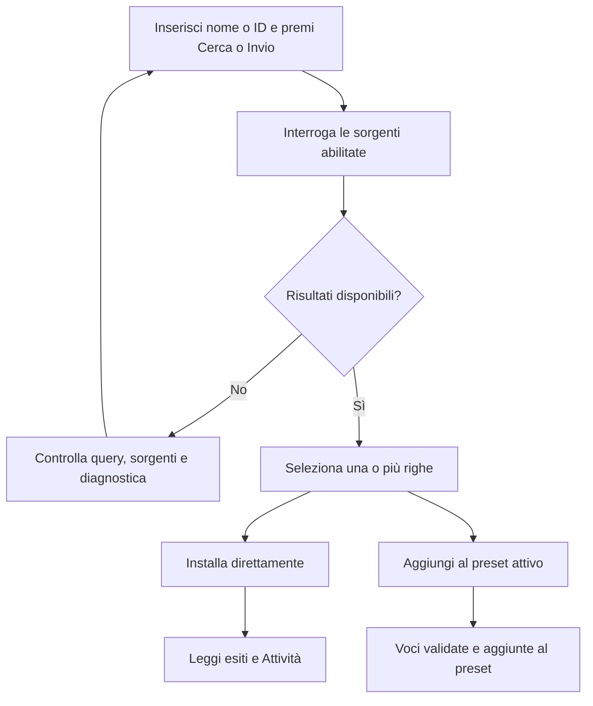
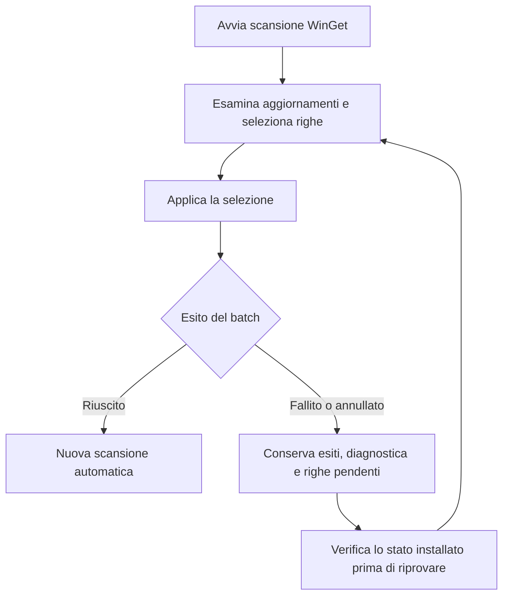
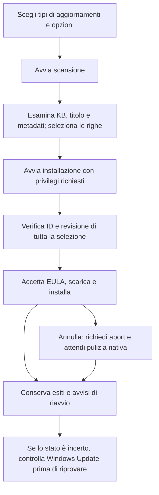
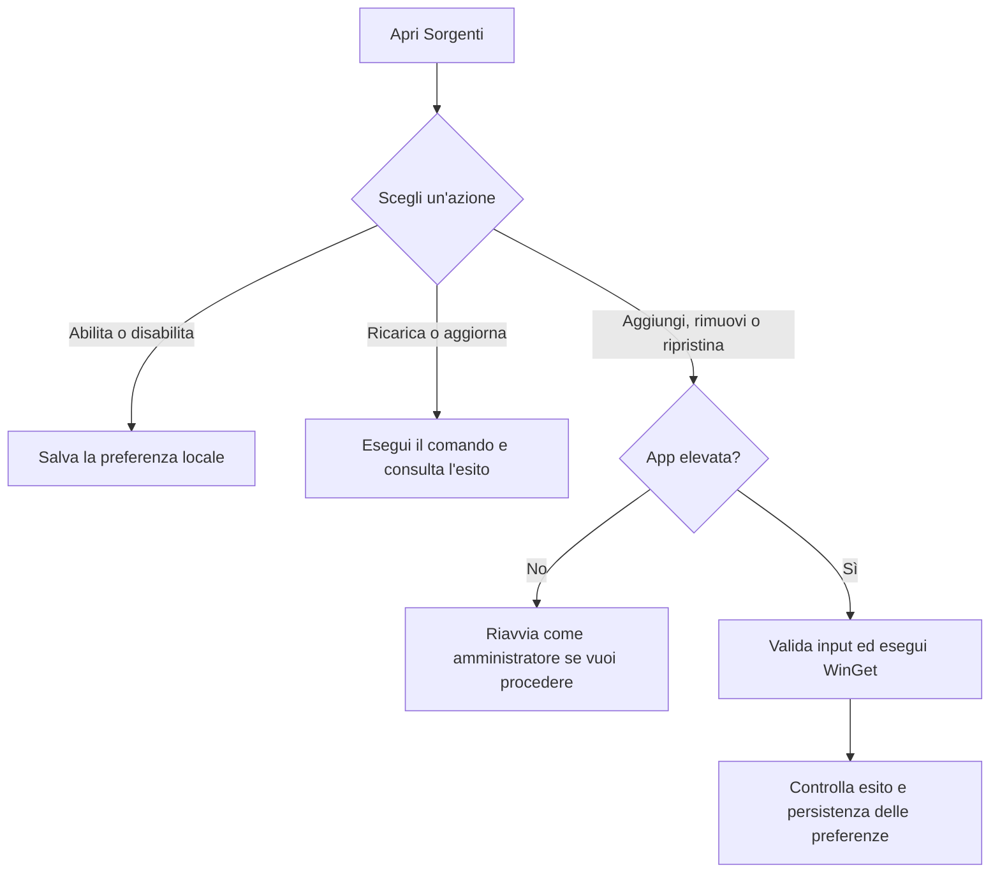
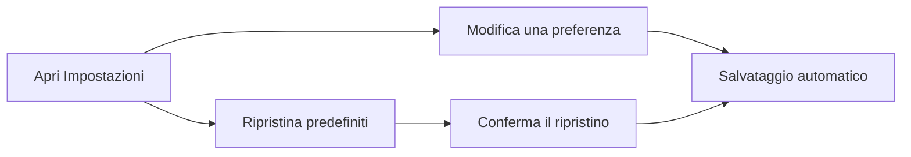

# Guida utente OnlyWinget

OnlyWinget riunisce liste riutilizzabili di applicazioni, ricerca WinGet e aggiornamenti delle app e di Windows. I nomi seguenti seguono l'interfaccia italiana; la lingua inglese è disponibile nelle impostazioni.

## Prima di iniziare

Avvia `OnlyWinget.exe` dopo l'installazione o l'estrazione completa dello ZIP. Verifica i [requisiti](../README.md#requirements). L'app legge le funzionalità disponibili e carica il workspace locale; gli errori di caricamento vanno risolti prima di salvare nuovi dati.

Il menu contiene Home, Pacchetti, Aggiornamenti, Sorgenti, Attività e Impostazioni. Cerca è una modalità di Pacchetti. Apri log consente di accedere alla diagnostica anche dal menu laterale.

Home mostra CPU, memoria, disco, uptime, versione di Windows e connettività, oltre allo stato operativo. Le metriche non sostituiscono una diagnosi completa della salute del PC.

## 1. Creare e usare un preset

In **Pacchetti → Preset**, crea una lista con un nome oppure selezionane una esistente. Aggiungi le applicazioni tramite ID e sorgente o dalla modalità Cerca. L'identità comprende entrambi: lo stesso ID da sorgenti diverse può rappresentare due voci distinte.

Importa ed esporta file nel formato `onlywinget.preset.v1`. L'importazione valida il documento e risolve i pacchetti nelle sorgenti abilitate prima di accettare il preset; un nome già esistente viene rifiutato. Un file JSON generico o l'export nativo di WinGet non è un preset OnlyWinget.

Le modifiche persistenti e il cambio del preset sono bloccati durante un'operazione. Se esiste una bozza, applicala oppure scartala prima di cambiare pagina, modalità o preset. Se la modifica è accettata ma il salvataggio fallisce, i campi restano bloccati e Applica riprova il salvataggio: non reinserire la stessa modifica.

Il cambio del preset attivo viene salvato automaticamente quando accettato. Se il salvataggio fallisce, consulta l'errore e usa Salva workspace per riprovare.

## 2. Cercare e installare applicazioni

Apri **Pacchetti → Cerca**, scrivi un nome o ID e avvia la ricerca. È necessaria almeno una sorgente abilitata. I risultati mostrano nome, ID, sorgente, versione e fornitore quando disponibili.

L'installazione diretta non richiede un preset. Un errore di una sorgente può lasciare disponibili i risultati delle altre: leggi anche gli avvisi. Le ricerche identiche possono usare una cache in memoria di cinque minuti.

## 3. Aggiornare le applicazioni WinGet

In **Aggiornamenti → WinGet**, avvia una scansione, confronta versione installata e disponibile e seleziona le righe da applicare. La copertura dipende da ciò che WinGet riconosce e dalle sorgenti disponibili.

**Annulla è una richiesta di interruzione.** Non garantisce che l'installer attivo completi o annulli il proprio lavoro. Gli esiti distinguono operazioni già concluse, pacchetto attivo non confermato e pacchetti mai avviati. Un errore o una cancellazione non provoca una nuova scansione automatica; le scansioni manuali conservano il riepilogo del batch.

## 4. Usare Windows Update

Apri **Aggiornamenti → Windows Update**. Le opzioni software, driver, Microsoft Update e aggiornamenti facoltativi sono separate. Per impostazione iniziale è selezionato il software; driver e facoltativi non sono inclusi. Seleziona almeno software o driver, poi avvia la scansione.

Avviando l'installazione, l'app accetta le EULA degli aggiornamenti selezionati dopo aver verificato la selezione completa. La gravità MSRC appare quando disponibile; il campo riavvio indica lo stato rilevato, non una previsione per ogni installazione futura.

Il fallback PowerShell serve quando COM non è attivabile: non ripete automaticamente un'installazione COM fallita. Se l'interruzione o la pulizia nativa non sono confermate, l'app segnala uno stato incerto. La cancellazione non effettua rollback; consulta il servizio Windows Update prima di un nuovo tentativo. Per i limiti delle prove reali, vedi [Operazioni](operations.md#windows-update-metadata).

## 5. Gestire le sorgenti

In **Sorgenti**, aggiorna l'elenco per vedere le sorgenti configurate in WinGet. Abilita o disabilita localmente quelle da usare nelle ricerche. Questa preferenza non rimuove la sorgente da WinGet.

| Azione | Privilegi e risultato |
| --- | --- |
| Ricaricare l'elenco | Disponibile senza elevazione; preserva URL e preferenze locali. |
| Aggiornare metadati | Esegue l'aggiornamento delle sorgenti tramite WinGet. |
| Abilitare/disabilitare | Salva una preferenza locale; non richiede amministratore. |
| Aggiungere/rimuovere/ripristinare | Richiede OnlyWinget avviato come amministratore; modifica la configurazione WinGet. |

OnlyWinget valida gli input; gli esiti di accesso e registrazione provengono da WinGet. Se una modifica nativa riesce ma il salvataggio locale fallisce, ricarica l'elenco prima di riprovare. Annullare non ripristina una modifica già completata.

## 6. Attività e log diagnostici

In **Attività** filtra per testo, gravità e categoria, copia i dettagli o esporta la cronologia. Cancella e Annulla riguardano la cronologia delle attività.

**Apri log** mostra invece i messaggi diagnostici con filtro, copia, esportazione e svuotamento. Lo svuotamento richiede conferma all'interno del visualizzatore; annullarla lascia i log invariati. Se la scrittura, l'esportazione o la cancellazione fallisce, leggi l'errore prima di riprovare. Controlla il testo esportato prima di condividerlo: può contenere percorsi e indirizzi delle sorgenti.

## 7. Impostazioni

Apri **Impostazioni** per scegliere lingua di sistema/inglese/italiano e tema di sistema/chiaro/scuro, conferme, diagnostica e livello dei log. Le preferenze includono anche la prosecuzione dopo un errore e l'opzione di bypass della verifica hash degli installer.

Le modifiche si salvano automaticamente. Il bypass hash modifica il controllo eseguito da WinGet e resta disattivato per impostazione predefinita. Ripristina predefiniti richiede conferma e salva nuovamente i valori iniziali.

## Dati locali e assistenza

Per impostazione predefinita, anche nell'edizione portatile, i dati sono in `%LOCALAPPDATA%\OnlyWinget`: database `onlywinget.db`, `settings.json`, `source-preferences-v1.json` e `logs`. I log ruotano a 10 MiB con un massimo di 14 file riconosciuti / 140 MiB dopo scritture riuscite.

In caso di errori di caricamento o migrazione, preserva i file e segui [le istruzioni di recupero](operations.md#workspace-schema-migration-and-recovery). Per segnalare un problema, indica versione, percorso operativo ed errore come descritto nel [README](../README.md#support).
