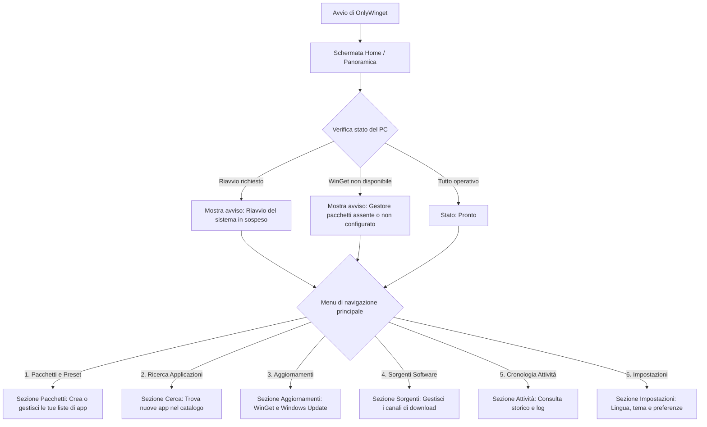
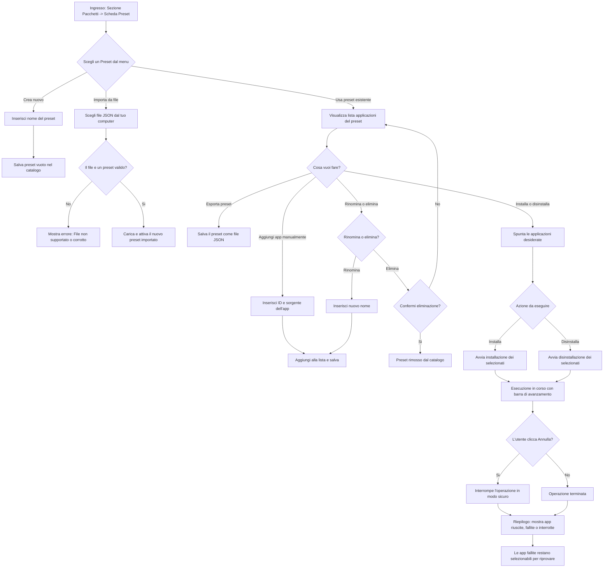
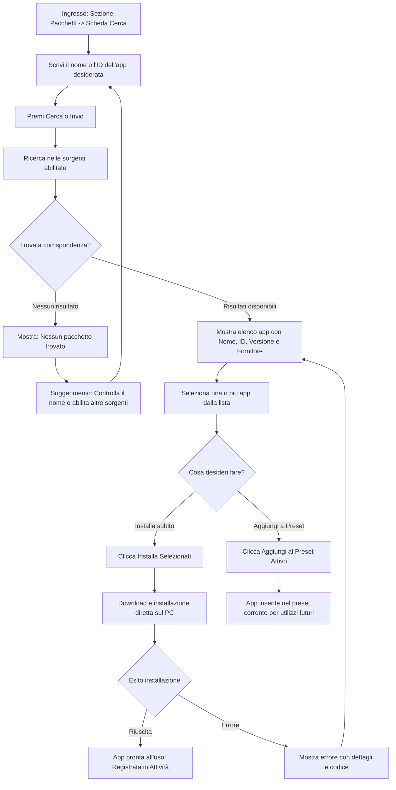
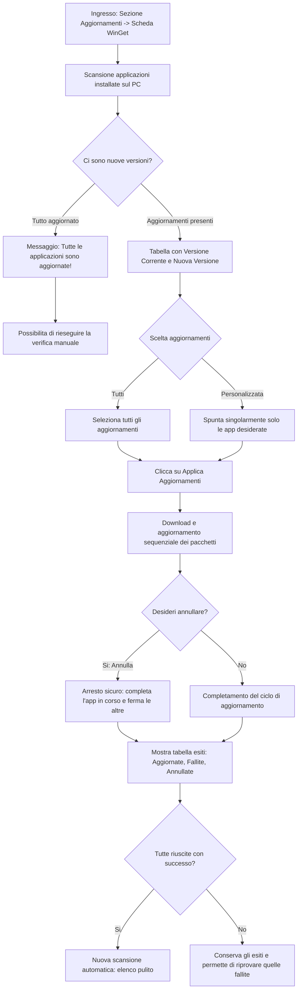
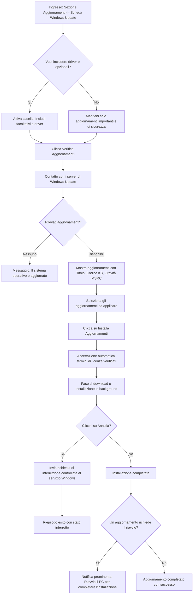
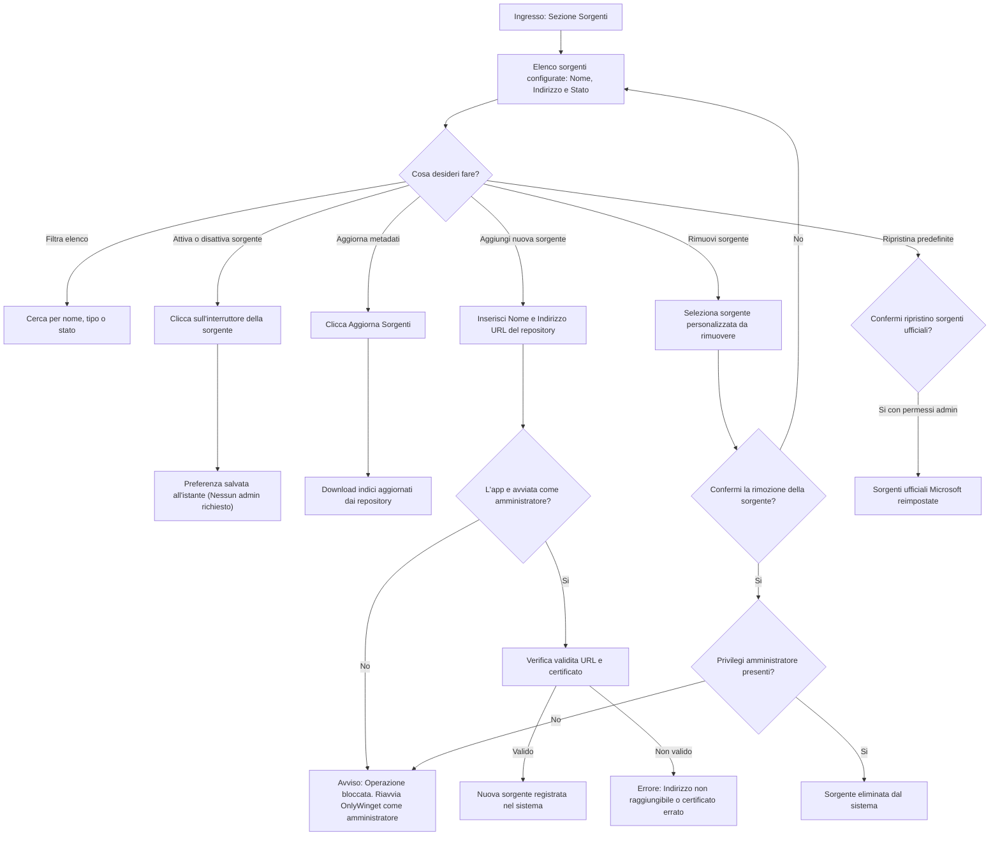
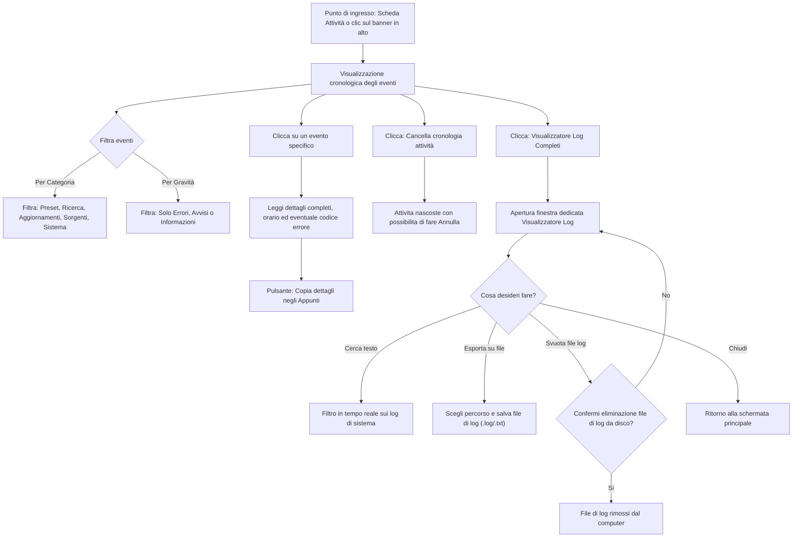
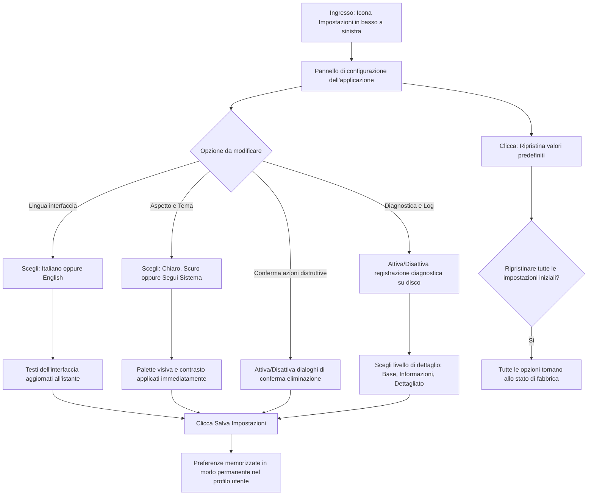

# Guida Visiva ai Percorsi Utente (OnlyWinget)

Questa guida illustra graficamente tutti i flussi di utilizzo di OnlyWinget per l'utente finale, descrivendo i punti di ingresso, le decisioni, le azioni, i risultati e i comportamenti in caso di errore o recupero.

---

## Indice dei Percorsi

1. [Navigazione Generale & Dashboard](#1-navigazione-generale--dashboard)
2. [Gestione dei Preset di Applicazioni](#2-gestione-dei-preset-di-applicazioni)
3. [Ricerca e Installazione Diretta di Applicazioni](#3-ricerca-e-installazione-diretta-di-applicazioni)
4. [Aggiornamenti Applicazioni (WinGet)](#4-aggiornamenti-applicazioni-winget)
5. [Windows Update (Aggiornamenti di Sistema)](#5-windows-update-aggiornamenti-di-sistema)
6. [Gestione Sorgenti Software (Repository WinGet)](#6-gestione-sorgenti-software-repository-winget)
7. [Cronologia Attività & Visualizzatore Diagnostico](#7-cronologia-attività--visualizzatore-diagnostico)
8. [Impostazioni & Personalizzazione](#8-impostazioni--personalizzazione)

---

## 1. Navigazione Generale & Dashboard

La schermata principale offre una visione d'insieme della salute del computer, delle metriche del sistema (processore, memoria, spazio su disco) e dei canali di aggiornamento.

---

## 2. Gestione dei Preset di Applicazioni

I preset consentono di memorizzare collezioni di programmi preferiti da installare o rimuovere in blocco (ad esempio per configurare un nuovo computer o un ambiente di lavoro).

---

## 3. Ricerca e Installazione Diretta di Applicazioni

Permette di cercare programmi nell'intero catalogo di WinGet e Microsoft Store, con la libertà di installarli immediatamente sul computer oppure di salvarli in un preset.

---

## 4. Aggiornamenti Applicazioni (WinGet)

Identifica i programmi installati sul PC che dispongono di una versione più recente e consente di aggiornarli singolarmente o tutti insieme.

---

## 5. Windows Update (Aggiornamenti di Sistema)

Esegue la scansione degli aggiornamenti ufficiali di Windows (inclusi aggiornamenti di sicurezza, driver e componenti opzionali) e ne gestisce l'installazione controllata.

---

## 6. Gestione Sorgenti Software (Repository WinGet)

Consente di visualizzare e configurare i canali da cui vengono scaricate le applicazioni (ad esempio il catalogo ufficiale WinGet o Microsoft Store).

---

## 7. Cronologia Attività & Visualizzatore Diagnostico

Registra ogni operazione eseguita per consentire all'utente di esaminare lo storico, verificare gli errori, copiare i dettagli o esportare i log per assistenza tecnica.

---

## 8. Impostazioni & Personalizzazione

Permette di personalizzare l'esperienza d'uso, la lingua, il tema grafico e le impostazioni di sicurezza dell'applicazione.

